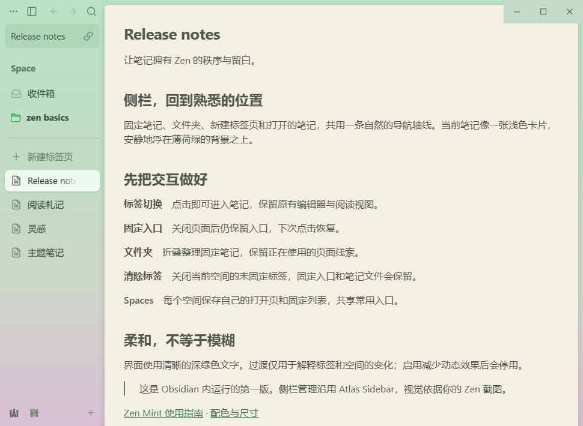
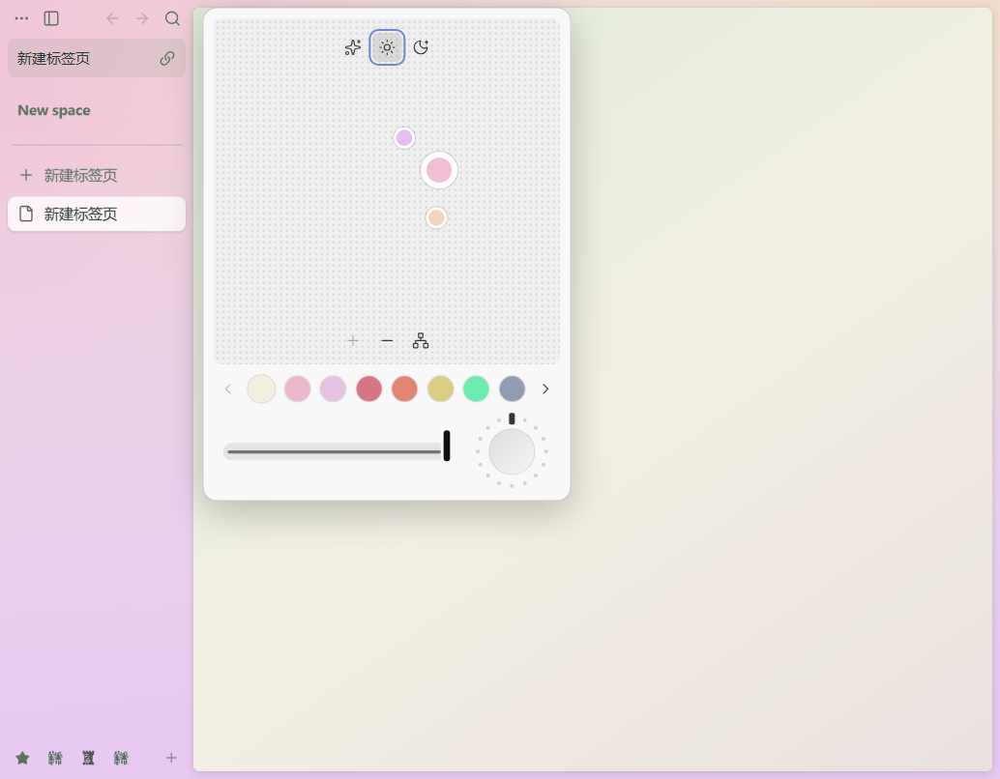

# Zen Mint for Obsidian

以提供的 Zen Browser 薄荷绿／淡粉截图为基准制作的 **Obsidian 主题 + 配套侧栏插件**，版本 0.2.2。

[下载 0.2.2 安装包](https://github.com/user-A100/zen-ob/releases/download/v0.2.2/Zen-Mint-0.2.2.zip) · [版本发布](https://github.com/user-A100/zen-ob/releases)



## Zen 原版主题编辑器

**侧栏空白处或顶部工具栏右键 → 更改主题…**。也可点击顶部 `… → 更改主题…`，或使用命令面板 `Zen Mint Sidebar: 更改主题`。



本版按 Zen 官方源码移植 380px 侧栏浮层：点阵调色板、最多 3 个联动色球、明暗三模式、加减色点、和谐算法切换、五页 41 个原版预设、波形颜色强度滑条和 16 档颗粒旋钮。拖动主色球实时预览；右键色球删除；方向键微调。关闭浮层即保存，不使用普通参数表单，也不需要 Style Settings。

颜色、强度和颗粒按 Space 保存；Auto/Light/Dark 全局生效。点击 Space 名称菜单中的“更改主题…”也可编辑该 Space，编辑非当前 Space 时临时预览，关闭后恢复当前 Space 的外观。

滑条在不透明 Electron 窗口里控制颜色浓度，旋钮控制颗粒纹理，**不控制渐变角度**。宿主适配仍使用 Obsidian 内置图标和 SVG 噪点，未模拟系统级桌面透明／触觉反馈。详细对应见 [原版移植规格](research/ZEN-THEME-SPEC.md)。

## 安装

需要桌面版 Obsidian **1.13.0 或更高版本**。本次实际验收环境为 Windows、Obsidian **1.14.5**。建议先在测试库体验。

1. 解压 `release/Zen-Mint-0.2.2.zip`。
2. 将 `themes/Zen Mint` 文件夹复制到你的笔记库 `.obsidian/themes/`。
3. 将 `plugins/zen-mint-sidebar` 文件夹复制到 `.obsidian/plugins/`。
4. 在“设置 → 外观”选择 **Zen Mint**，使用浅色模式可得到参考截图配色。
5. 在“设置 → 第三方插件”中启用 **Zen Mint Sidebar**。如列表未刷新，重新加载 Obsidian。
6. 如果已安装 Vertical Tabs、Atlas Sidebar 或 Zen UI，请先停用，避免多个标签管理器同时接管布局。

ZIP 中的文件夹可以分别复制，不会覆盖你的整个 `.obsidian` 目录。首次使用不包含任何示例固定笔记；预览中的笔记只存在于本项目测试库。

## 操作

| 控件 | 行为 |
|---|---|
| 顶部 `…` | 打开文件列表、搜索、创建空间、进入设置 |
| 顶部侧栏按钮 | 收起侧栏；收起后左上角有展开按钮 |
| 后退／前进 | 当前笔记标签内的导航历史 |
| 新建标签页、Ctrl/Cmd+T | 创建独立空白标签并打开搜索；Esc 保留空白页，不创建文件 |
| 顶部笔记名、搜索按钮 | 搜索已有文件；已打开则切换，Ctrl/Cmd+Enter 在独立标签中打开 |
| 搜索结果中的新建操作 | 只有明确选择“新建 Markdown 笔记／白板／数据库”才创建对应文件 |
| 标签右键 → 在独立标签中再次打开 | 多开同一篇笔记；多个视图共享同一个文件 |
| Windows 内容区顶边 | 整条 8px 横带触发，等待 200ms 后以 150ms 过渡展开 34px 控制条；正文保持原位 |
| 链接图标 | 将当前笔记的内部链接复制到剪贴板 |
| 标签 | 点击切换；悬停关闭；中键关闭 |
| 右键标签 → Pin tab | 保留固定入口；关闭页面后入口仍在，点击恢复 |
| 文件夹 | 点击折叠；右键创建、重命名及设置颜色 |
| 分隔线上的“清除” | 关闭当前空间的未固定标签，保留固定入口和其他空间 |
| 底部图标、加号 | 切换或添加 Spaces |

二级菜单和高级设置部分沿用上游英文。文件列表／搜索核心插件仍可从菜单进入，切回 Zen 标签可使用底部原生侧栏标签按钮或命令面板中的 `Zen Mint Sidebar: Show tabs sidebar`。

主题与插件可分别使用。配套插件负责侧栏和 Zen 主题编辑器，主题负责基本外观。可通过 Obsidian 原生拖拽调整侧栏宽度。旧的 Style Settings 控制项仅作为兼容入口保留；某个 Space 经原版主题编辑器调色后，以该 Space 的主题为准。截图对照时界面字号为 15px、标签行高为 36px、测试侧栏为 174 CSS px；可按实际屏幕缩放调整宽度。

## 本版范围

- 参考图的薄荷绿到淡粉侧栏、奶油内容卡、浅色选中标签、文件夹和导航层级。
- 竖向标签、固定入口、文件夹、搜索启动器、Spaces、HTML 拖拽排序与卸载清理。
- 暗色配色、键盘焦点与减少动画模式。
- 外观开关使用可撤销 CSS 类，不再改写笔记库的 `showRibbon` 和 `showViewHeader` 偏好。

这是首轮高保真实现，尚未完成逐像素验收。Windows 窗口控制条按原版单工具栏布局实现整条顶边触发、8→34px 高度变化、200ms 等待和 150ms 过渡，悬停、所属菜单或控制条焦点保持展开，隐藏时禁用按钮命中。正文位置不随控制条变化。Electron 没有 Zen 原生的跨窗鼠标追踪，离开顶边使用有界 1000ms 回退；失焦清理状态。详见 [源码对照](research/ZEN-AUTOHIDE-SPEC.md)。侧栏 Compact Mode 的完整自动隐藏仍不包含在本次窗口控制条改动中。

0.2.2 同时修复截图测试固定视口残留引发的右侧／底部白边，以及内容卡 100% 高度再加边距造成的底边溢出。验收使用真实窗口尺寸、80%／125% 缩放与 Electron 原生整窗截图，不再以固定视口截图代替整窗验证。字体渲染、浏览器站点图标和桌面壁纸透视仍有宿主差异。

Atlas 上游的分屏功能仍保留，依赖部分宿主内部 API，**不列入本版验收承诺**。移动端没有验证，插件清单限定桌面版。

## 验证与来源

- [候选底座对比](research/BASE-EVALUATION.md)
- [真实应用验收记录](artifacts/acceptance.json)
- [测试范围与截图条件](VALIDATION.md)
- [上游来源和许可证](THIRD-PARTY-NOTICES.md)

侧栏底座选择 **Atlas Sidebar 1.0.2** 的 MIT 源码，固定提交为 `71675faced6d9d926eb566b8aa280728956e7c35`。无需另装 Atlas Sidebar 或 Atlas VTT。0.2.0 的主题编辑器移植自 Zen Browser 固定提交 `f2b18c4f6179a3918c0d92f2a7406322cda4ad12`，相关文件遵循 MPL-2.0；安装包携带修改后的源文件和许可证。

## 开发

```sh
npm ci
npm --prefix plugin ci
npm run build
```

主题源码：`theme/theme.css`。插件源码：`plugin/`，新增工具栏在 `mint-toolbar.ts`，基础交互样式在 `mint-chrome.css`，上游样式在 `sidebar.css`。构建生成 `main.js` 和 `styles.css`。

后台集成测试需要已安装的 Obsidian 和工作区内的独立测试库。`scripts/deploy-test.ps1` 只复制到本项目 `test-vault`；`scripts/run.cjs` 和验收脚本都拒绝操作其他名称的库。调试端口固定为本机 9224。测试不会依赖用户正在编辑的个人库。

```sh
npm test
npm run capture
```

测试数据由 `scripts/prepare-demo.js` 生成，仅用于隔离库，会重设该测试库的示例笔记和布局；不要用于个人库。打包使用 `scripts/package.ps1`。`test-profile/`、`test-vault/`、候选仓库与依赖不会进入发布包或 Git。

## License

Atlas 侧栏及原创主题部分遵循 MIT，Zen 主题编辑器移植文件遵循 MPL-2.0，继承的图标素材使用 CC BY 3.0，详见 THIRD-PARTY-NOTICES。完成修改后请上传到自己的 GitHub 仓库，保留来源、修改后的 MPL 源码与许可证。
